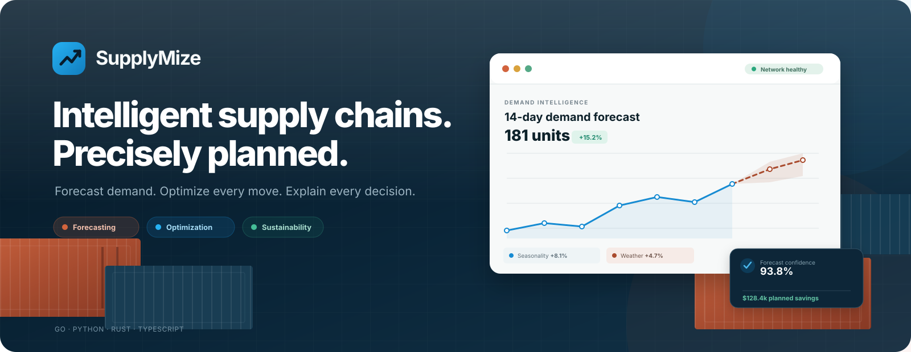
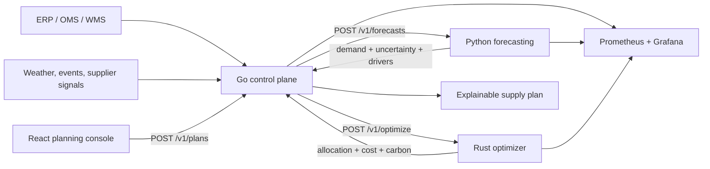
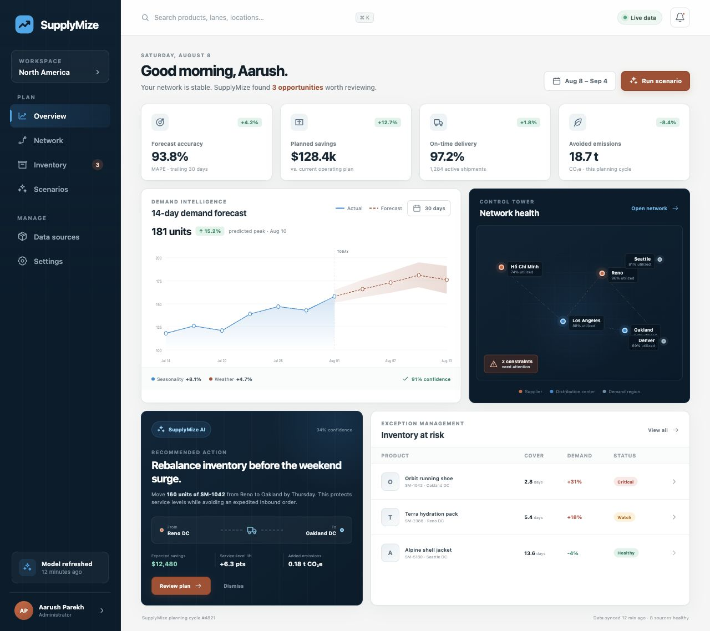

<div align="center">



[](https://github.com/rooshyp/supplymize/actions/workflows/ci.yml)
[](https://github.com/rooshyp/supplymize/actions/workflows/codeql.yml)
[](LICENSE)
[](services/control-plane)
[](services/forecasting)
[](services/optimizer)
[](apps/console)

**An explainable, carbon-aware planning platform for forecasting demand and optimizing supply networks.**

[Quick start](#quick-start) · [Architecture](#architecture) · [API](docs/api.md) · [Operations](docs/operations.md) · [Roadmap](docs/roadmap.md)

</div>

---

SupplyMize turns demand evidence and supply-network constraints into one traceable plan. It blends historical demand with trend, seasonality, weather, event, and supplier-speed signals; then minimizes transport, storage, lost-sales, and priced-carbon costs across a capacity-constrained network.

The repository is a production-oriented reference implementation of the planning core. It includes strict contracts, deterministic models, service isolation, observability, containerization, Kubernetes deployment, security guidance, and a polished control-tower experience. Enterprise connectors, durable plan persistence, SSO, and autonomous execution remain explicit roadmap work—not hidden demo dependencies.

## What it delivers

- **Explainable forecasts** — daily point estimates, confidence intervals, component contributions, assumptions, and model metadata.
- **Feasible network plans** — supplier-to-warehouse allocations under inventory, storage, and truck-lane capacity limits.
- **Economically honest trade-offs** — separate transport, storage, lost-sales, and carbon cost terms, including explicit unfulfilled demand.
- **One public planning boundary** — a Go control plane validates inputs, propagates request IDs and deadlines, and shields clients from internal service changes.
- **Operational readiness** — structured logs, Prometheus metrics, Grafana provisioning, probes, non-root containers, network policy, CI, and CodeQL.
- **A planner-first console** — a responsive TypeScript interface for demand signals, network health, recommendations, and inventory risk.

## Architecture



| Layer | Technology | Responsibility |
| --- | --- | --- |
| Planning console | React 19 + TypeScript + Vite | Forecast, exception, network, and scenario experience |
| Control plane | Go standard library | Public API, validation, orchestration, deadlines, correlation, resilience |
| Forecasting | Python + FastAPI + Pydantic | Multi-signal demand ensemble, uncertainty, and driver explanations |
| Optimization | Rust + Axum | Deterministic min-cost network flow and binding-constraint reporting |
| Platform | Docker, Kubernetes, Prometheus, Grafana | Packaging, policy, probes, scaling, and telemetry |

The backends share the same dependency direction: **HTTP transport → application use cases → domain rules**, with adapters translating external contracts. Read the [architecture guide](docs/architecture.md) and [polyglot ADR](docs/adr/0001-polyglot-monorepo.md) for the rationale.

## Planning objective

For a single SKU and planning horizon, SupplyMize minimizes:

```text
transport cost
+ storage cost
+ unfulfilled demand × lost-sale penalty
+ emitted CO₂e × internal carbon price
```

subject to supplier availability, warehouse capacity, directed lane capacity, and forecast demand. A partial plan remains useful: it reports what can be fulfilled, what cannot, and why.

## Quick start

The fastest path is Docker Compose:

```bash
git clone https://github.com/rooshyp/supplymize.git
cd supplymize
cp .env.example .env
docker compose up --build
```

Once healthy:

| Surface | Address |
| --- | --- |
| Planning console | <http://localhost:4173> |
| Public planning API | <http://localhost:8080> |
| Forecasting API | <http://localhost:8001> |
| Optimization API | <http://localhost:8002> |

Create an end-to-end plan:

```bash
curl --fail-with-body \
  --request POST http://localhost:8080/v1/plans \
  --header 'Content-Type: application/json' \
  --header 'X-Request-ID: supplymize-demo-001' \
  --data @examples/plan-request.json
```

Enable the optional observability stack with:

```bash
docker compose --profile observability up --build
```

Prometheus is then available at <http://localhost:9090> and the provisioned Grafana workspace at <http://localhost:3000> (`admin` / `supplymize-local` for local development only).

## API surface

| Service | Method and path | Purpose |
| --- | --- | --- |
| Control plane | `POST /v1/plans` | Forecast demand and return an optimized network plan |
| Forecasting | `POST /v1/forecasts` | Run the explainable multi-signal forecast directly |
| Forecasting | `GET /v1/model/info` | Inspect model method, drivers, and supported bounds |
| Optimizer | `POST /v1/optimize` | Solve a capacity-constrained allocation directly |
| Every backend | `GET /healthz` · `GET /readyz` · `GET /metrics` | Liveness, readiness, and Prometheus exposition |

Versioned OpenAPI contracts live in [`contracts/openapi`](contracts/openapi), and runnable payloads live in [`examples`](examples). Unknown fields are rejected at service boundaries so contract drift fails early.

## Control tower



The console is a responsive reference experience backed by typed scenario fixtures. The service APIs are fully callable today; authenticated live data sources and durable scenario workflows are part of the connected-operations phase.

## Repository map

```text
apps/console/                 React + TypeScript planning console
services/control-plane/      Go public API and orchestration layer
services/forecasting/        Python explainable forecast service
services/optimizer/          Rust min-cost network optimizer
contracts/openapi/           Reviewed service contracts
examples/                    End-to-end and direct-service requests
infra/kubernetes/            Kustomize base, probes, HPA, and network policy
observability/               Prometheus and Grafana provisioning
docs/                        Architecture, API, operations, security, roadmap, ADRs
.github/                     CI, CodeQL, ownership, issue and PR templates
```

## Local development

Component development requires Node.js 22+, pnpm 11+, Go 1.22+, Python 3.11+, and Rust 1.85+. Docker is only required for the integrated stack.

```bash
make bootstrap       # install JavaScript and Python dependencies
make test            # run TypeScript, Go, Python, and Rust tests
make build           # build the console and compiled services
```

Language-native checks are documented in each service README. CI also verifies formatting, linting, race safety, coverage, release builds, and all four container builds.

## Production posture

The checked-in deployment baseline provides:

- non-root, least-privilege containers;
- bounded request bodies and strict numeric/domain validation;
- health and readiness probes with graceful shutdown;
- resource requests/limits and horizontal scaling;
- deny-by-default backend network policy;
- request correlation without logging customer payloads;
- weekly CodeQL analysis and dependency update automation.

Before production use, add authenticated TLS ingress, workload identity or mTLS, a managed secret store, tenant isolation, durable plan/audit storage, source-system data lineage, and organization-specific retention controls. See the [threat model](docs/security.md) and [security policy](SECURITY.md).

## Roadmap

- **Now:** forecasting, constrained optimization, explainable plans, control tower, containers, Kubernetes, and telemetry.
- **Next:** ERP/WMS connectors, persistent scenarios, SSO/RBAC, decision audit, backtesting, drift detection, and webhooks.
- **Later:** live IoT telemetry, dynamic rerouting, multi-echelon inventory, supplier substitution, and policy-governed automation.

See the full [product roadmap](docs/roadmap.md).

## Contributing

Read [CONTRIBUTING.md](CONTRIBUTING.md), follow the [Code of Conduct](CODE_OF_CONDUCT.md), and report vulnerabilities through GitHub private vulnerability reporting as described in [SECURITY.md](SECURITY.md).

## License

Licensed under the [MIT License](LICENSE).
