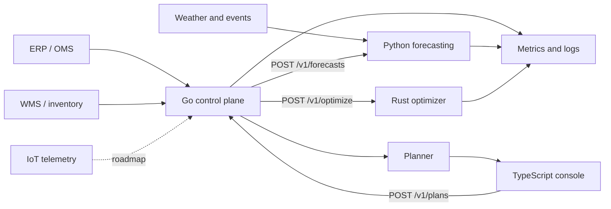
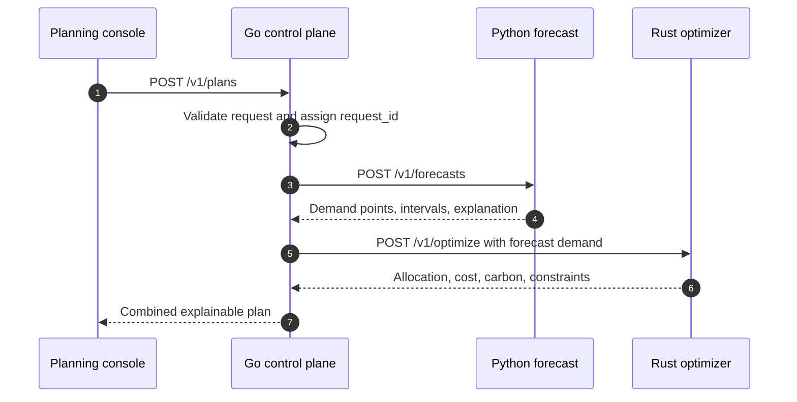

# SupplyMize architecture

SupplyMize is a polyglot planning platform built around one operational loop: **sense demand, decide the best response, and explain the plan**. Each service owns a narrow problem and exposes a versioned HTTP contract. The control plane keeps clients insulated from model and solver changes.

## System context



## Components

| Component | Runtime | Responsibility | Why this runtime |
| --- | --- | --- | --- |
| Planning console | TypeScript + React | Forecasts, network health, exceptions, and scenario decisions | Typed UI composition and a strong component ecosystem |
| Control plane | Go | Validation, request IDs, orchestration, deadlines, and downstream resilience | Predictable concurrency and small deployment footprint |
| Forecasting | Python + FastAPI | Explainable demand forecast and uncertainty intervals | Mature modeling ecosystem and readable analytical code |
| Optimizer | Rust + Axum | Capacity-aware allocations and cost/carbon minimization | Memory safety, deterministic performance, and precise domain types |

## Planning request lifecycle



The forecast is deliberately completed before optimization because forecast demand is a solver input. Independent data enrichment calls can be added in parallel without changing the public contract.

## Layer boundaries

All backend services follow the same dependency direction:

```text
transport (HTTP) -> application (use cases) -> domain (rules and types)
                                      |
                                      v
                               adapters (clients)
```

- **Transport** owns serialization, status codes, and correlation headers.
- **Application** coordinates the use case and sets deadlines.
- **Domain** contains deterministic rules with no network or framework dependency.
- **Adapters** translate external contracts into domain inputs.

This keeps forecasting math and optimization rules independently testable and makes a future switch from HTTP to a queue or gRPC a boundary change instead of a rewrite.

## Failure model

| Failure | Behavior |
| --- | --- |
| Invalid planning request | Rejected at the edge with a stable error envelope |
| Forecast timeout or 5xx | Control plane returns a dependency error; it never invents demand |
| Infeasible allocation | Optimizer returns fulfilled and unfulfilled demand plus violated constraints |
| Client cancellation | Propagated to downstream requests |
| Process shutdown | Readiness drops and in-flight work receives a graceful drain window |

Every service exposes `/healthz` for liveness, `/readyz` for dependency readiness, and `/metrics` for operational telemetry.

## Security posture

- Untrusted payloads are bounded and validated at every service boundary.
- Containers run as unprivileged users and expose only service ports.
- Network policy limits backend ingress to the control plane and metrics collector.
- CI runs CodeQL, language-native tests, container builds, and Dependabot-managed update automation.
- Production authentication belongs at the ingress/API gateway; service-to-service identity can use mTLS without changing the domain model.

See [security.md](security.md) for the threat model and reporting policy.

## Deployment model

`compose.yaml` is the local reference environment. `infra/kubernetes` contains production-oriented manifests with probes, resource requests, horizontal scaling, and deny-by-default network policy. The services remain stateless in this release; source-system connectors and plan persistence are explicit roadmap layers rather than hidden demo dependencies.

## Design constraints inherited from the concept

The original SupplyMize concept defined the optimization objective as:

```text
minimize transport cost + storage cost + lost-sales penalty + priced carbon
```

subject to available inventory, warehouse space, lane/truck capacity, and forecast demand. It also called for signals from historical sales, trend, seasonality, weather, events, and supplier speed. Those are first-class contract fields rather than hard-coded demo values.
